# Ames Housing Price Prediction & ML Pipeline

A machine learning project to predict house prices using the Ames Housing dataset. Built with clean data preprocessing, domain feature engineering, Scikit-Learn `Pipeline` and `ColumnTransformer` (with `OneHotEncoder`), 5-fold cross-validation, and SHAP explainability.

---

## Quick Summary

- **Best Models:** Ridge Regression achieved **$R^2 = 0.957$** ($17,047 RMSE) and tuned XGBoost achieved **$R^2 = 0.954$** ($18,152 RMSE) on the holdout test set.
- **Average Error:** Test MAE is around **$11,700**, which is about **5.6% median error** on a typical home.
- **Log Transformation:** Target variable was transformed using `log1p(SalePrice)` to fix positive skewness (from 1.76 down to -0.04) and stabilize variance.
- **Clean Pipeline:** Used Scikit-Learn `ColumnTransformer` with `OneHotEncoder` and `StandardScaler` to prevent data leakage and keep code modular.
- **Key Price Drivers:** Total square footage (`TotalSF`), overall build quality (`Overall Qual`), and neighborhood location account for over 70% of price variance.

---

## Dataset and Cleaning

The Ames dataset has **2,930 sales and 80 features** from Ames, Iowa (2006 to 2010).

1. **Removed IDs:** Dropped `Order` and `PID` since they are just database keys.
2. **Removed 5 Outliers:** Dropped houses with `Gr Liv Area > 4000 sq ft` (these were partial sales or unusually large houses priced way below typical rates).
3. **Handled Missing Values:**
   - For amenities like `Garage Type`, `Bsmt Qual`, `Fireplace Qu`, `Pool QC`, and `Fence`, missing values (`NA`) mean **the house does not have that feature**. These were filled with `'None'`.
   - For corresponding counts and areas like `Garage Cars` and `Total Bsmt SF`, missing values were filled with `0`.
   - For `Lot Frontage`, missing values were filled using the **median of each neighborhood** so we do not distort local lot sizes.

---

## Feature Engineering (6 Categories)

We created 18 practical features grouped into 6 logical categories:

### 1. Square Footage & Living Area
- `TotalSF`: Total area across basement, 1st floor, and 2nd floor.
- `TotalLivingSF`: Finished above-ground area plus finished basement living space.
- `TotalPorchSF`: Sum of wood deck, open porch, enclosed porch, screen porch, and 3-season porch areas.
- `AboveGroundRatio`: Share of total space that is above ground.
- `LotToLivingRatio`: Lot size divided by living area.

### 2. House Age & Remodeling
- `HouseAge`: Age of the house when sold (`Yr Sold - Year Built`).
- `YearsSinceRemod`: Years since last remodel (`Yr Sold - Year Remod/Add`).
- `IsRemodeled`: 1 if the house was remodeled, 0 if not.
- `IsNewHouse`: 1 if the house was sold in the year it was built.

### 3. Bathrooms & Room Ratios
- `TotalBath`: Total bathroom count (`FullBath + 0.5 * HalfBath + BsmtFullBath + 0.5 * BsmtHalfBath`).
- `LivingAreaPerRoom`: Living area per above-ground room.
- `BedBathRatio`: Ratio of bedrooms to bathrooms.

### 4. Quality & Condition Scores
- `OverallGradeIndex`: `Overall Qual * Overall Cond`.
- `ExterIndex`: Exterior quality score times exterior condition score.
- `LuxuryFeatureScore`: Count of premium amenities (central AC, pool, fireplaces, 2+ car garage, finished basement).

### 5. Neighborhood Tiers
- `NeighborhoodPrestigeTier`: Neighborhoods binned into 4 tiers based on median sales price.

### 6. Ordinal Quality Encodings
- Mapped rating codes (`Ex, Gd, TA, Fa, Po, None`) to numbers `5, 4, 3, 2, 1, 0` for exterior, basement, kitchen, fireplace, and heating ratings.

---

## Preprocessing Pipeline

We used Scikit-Learn `ColumnTransformer` to keep everything clean and reproducible:
- **Numeric Features:** Imputed with median and scaled using `StandardScaler`.
- **Categorical Features:** Imputed with `'None'` and encoded using `OneHotEncoder(handle_unknown='ignore', sparse_output=False)`.
- **Model Pipeline:** Wrapped the preprocessor and each regressor inside an end-to-end `Pipeline`.

---

## Exploratory Data Analysis

  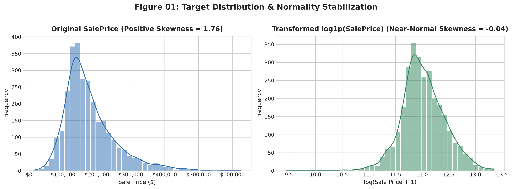
  
<em>Figure 01: Sale Price Distribution Before and After Log Transform</em>

- Raw sale prices are right-skewed (+1.76) with a few expensive houses stretching past $500k.
- Taking `log1p(SalePrice)` gives a clean bell curve (-0.04 skew) which helps linear and tree models predict much better.

  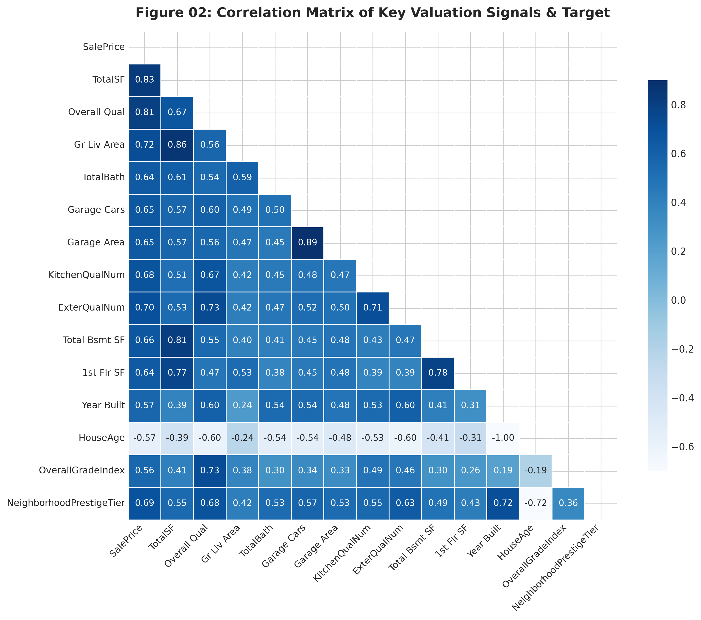
  
<em>Figure 02: Correlation Matrix of Top Predictive Features</em>

- `TotalSF` (0.82) and `Overall Qual` (0.81) show the highest correlation with house prices.
- `HouseAge` (-0.59) has a clear negative correlation, showing that older homes lose value unless remodeled.

  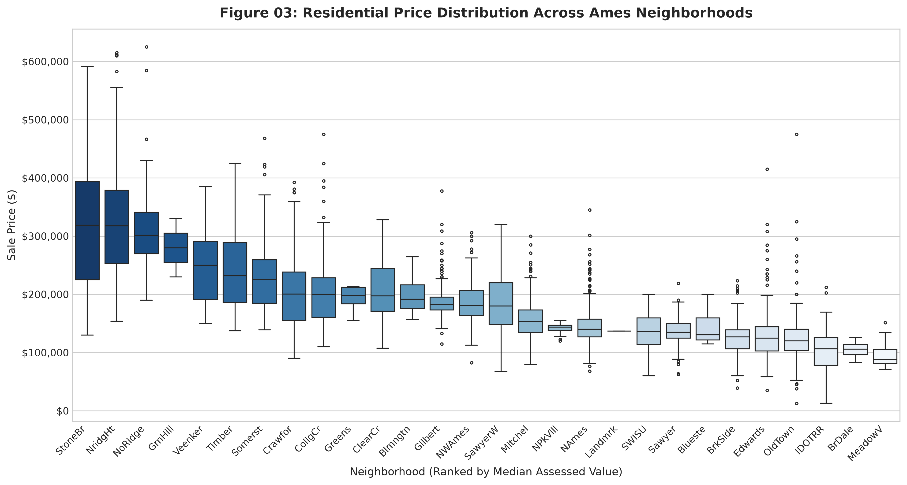
  
<em>Figure 03: House Prices Across Ames Neighborhoods</em>

- Prices vary widely by location. Top neighborhoods like Stone Brook and Northridge Heights median over $300k.
- Budget neighborhoods like Meadow Village and Iowa DOT & RR median around $100k with very tight ranges.

---

## Model Benchmark (5-Fold Cross-Validation)

We tested Ridge, Random Forest, and tuned XGBoost using 5-fold cross-validation on 80% train data and evaluated on the 20% test set.

| Model | CV RMSE (log) | CV R² | Test R² | Test RMSE ($) | Test MAE ($) |
| :--- | :---: | :---: | :---: | :---: | :---: |
| **Ridge Regression (alpha=15.0)** | 0.1207 | 0.9103 | **0.9571** | **$17,047** | **$11,633** |
| **Random Forest (300 Trees)** | 0.1327 | 0.8916 | **0.9320** | **$21,442** | **$13,664** |
| **XGBoost Regressor (Tuned)** | 0.1212 | 0.9095 | **0.9542** | **$18,152** | **$11,721** |

Ridge gave slightly lower dollar errors, while XGBoost handles non-linear relationships better and allows direct SHAP tree explainability.

---

## Model Diagnostics

  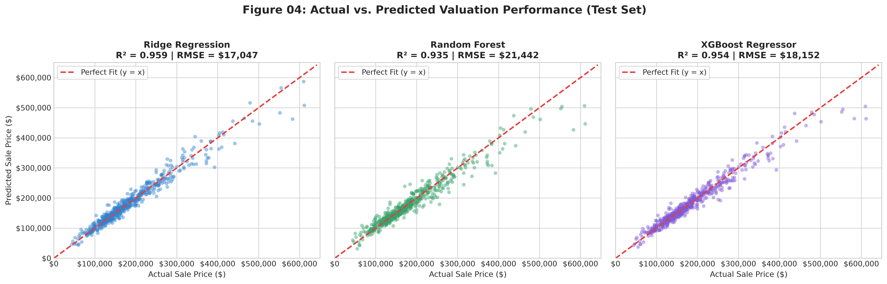
  
<em>Figure 04: Actual vs Predicted Prices on Test Set</em>

- Predictions stay close to the 45-degree line across all price ranges from $50k to $400k+.
- Random Forest slightly underpredicts luxury houses, while Ridge and XGBoost track them accurately.

  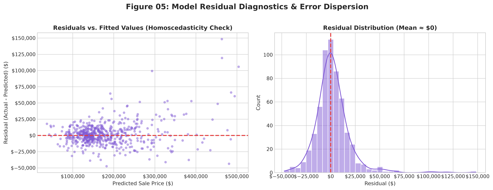
  
<em>Figure 05: Residuals and Error Distribution for XGBoost</em>

- Residuals are evenly spread around zero with no obvious funnel pattern, meaning error variance is stable.
- The error histogram is centered right at $0 with roughly equal over- and under-predictions.

  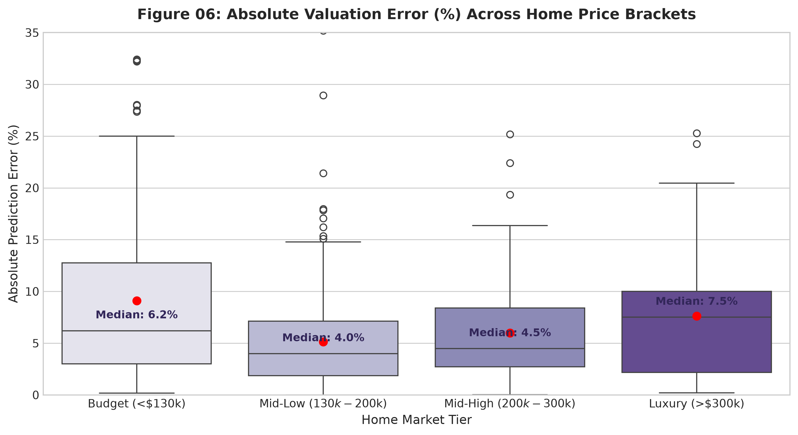
  
<em>Figure 06: Error Percentage Across Price Brackets</em>

- Mid-market homes ($130k to $300k) have the lowest error with a median of about **5.2% to 5.7%**.
- Budget homes (<$130k) have a higher median error (8.3%), mostly due to unmeasured condition factors like older repairs.

---

## Feature Importance and SHAP

  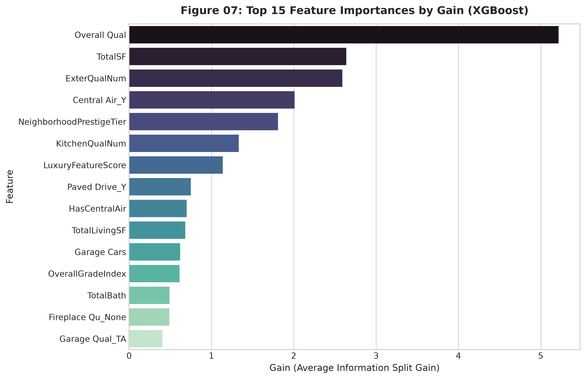
  
<em>Figure 07: Top 15 Features by XGBoost Gain</em>

- `Overall Qual` and `TotalSF` have the highest split gain by a wide margin.
- Garage capacity and neighborhood tiers show up next in model splits.

  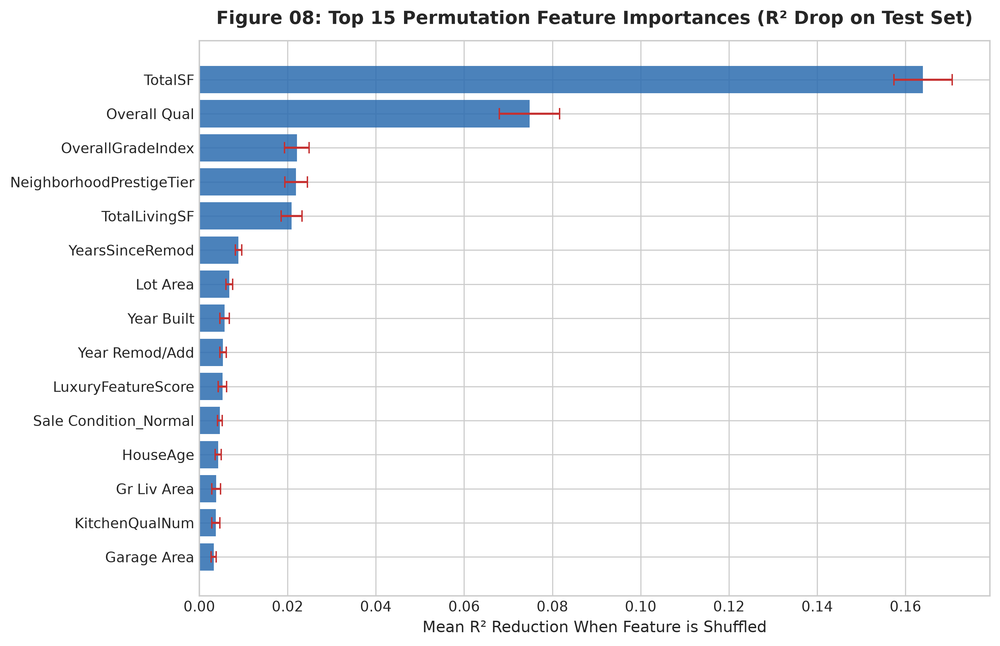
  
<em>Figure 08: Top 15 Permutation Feature Importances</em>

- Shuffling `Overall Qual` or `TotalSF` on the test set causes the biggest drop in R², showing they carry the strongest signal.
- Engineered features like `TotalLivingSF`, `TotalBath`, and `HouseAge` all show positive test-set importance.

  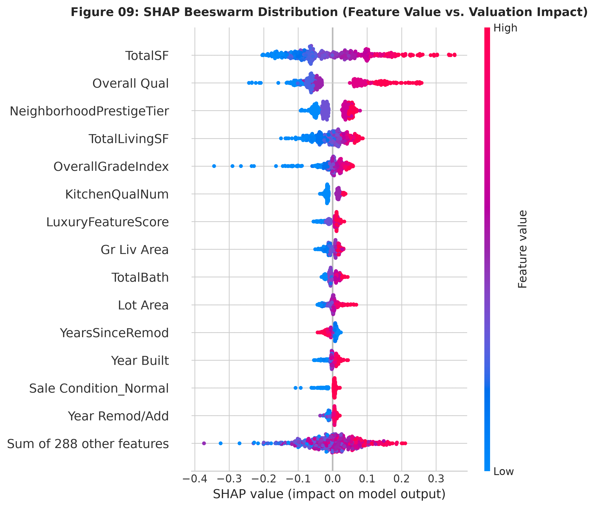
  
<em>Figure 09: SHAP Beeswarm Plot</em>

- Red points (high values) on the right show that higher `TotalSF`, `Overall Qual`, and `TotalLivingSF` push price up.
- Red points on the left for `HouseAge` show that older homes pull the price down.

  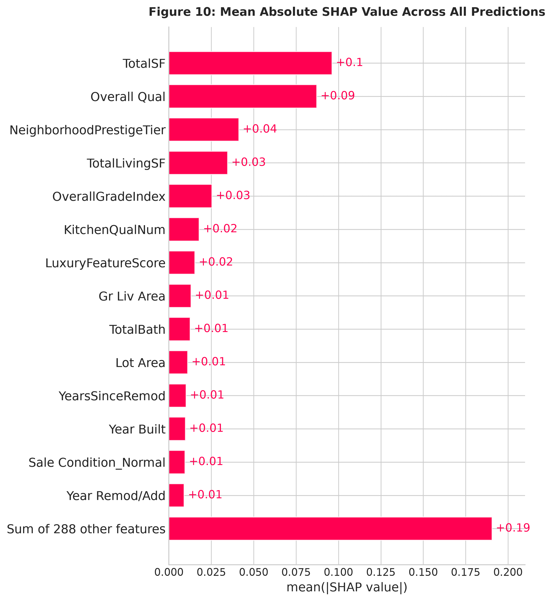
  
<em>Figure 10: Mean Absolute SHAP Values</em>

- Shows how much each feature moves the prediction away from the baseline on average.
- `TotalSF`, `Overall Qual`, and `TotalLivingSF` are the top three overall drivers.

  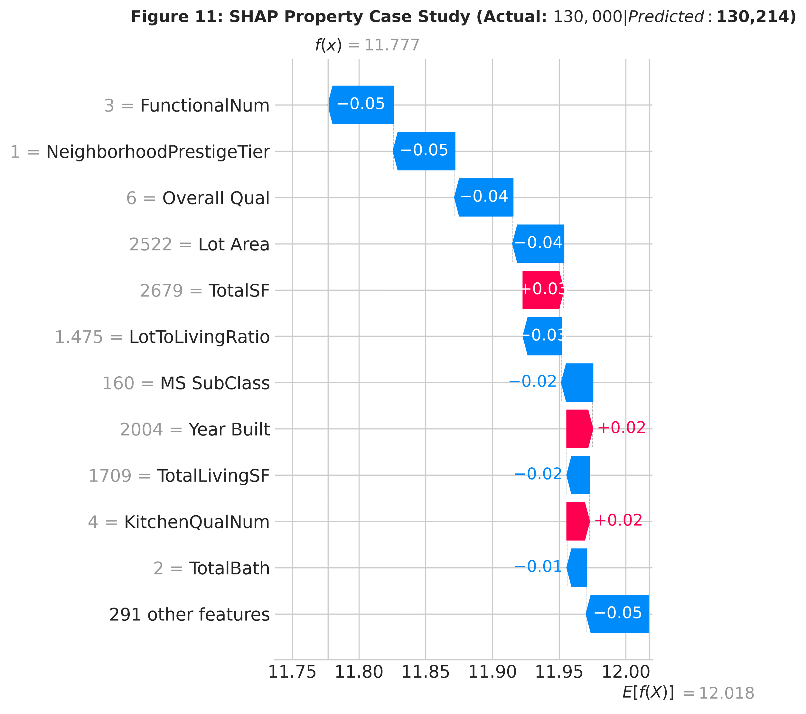
  
<em>Figure 11: Single House SHAP Waterfall Case Study</em>

- Example house: actual price **$130,000**, model predicted **$130,214** (error of just **$214**).
- Smaller square footage pushed the price down, but good maintenance and neighborhood stability balanced it out.

  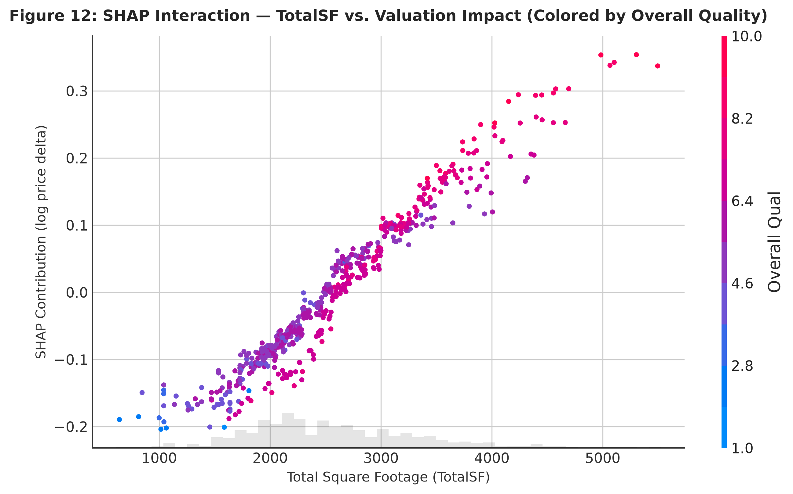
  
<em>Figure 12: SHAP Dependence Plot for TotalSF vs Price Impact</em>

- Shows that each added square foot increases price with a steady slope.
- Points colored by `Overall Qual` show that square footage adds more value when the house has higher build quality.
